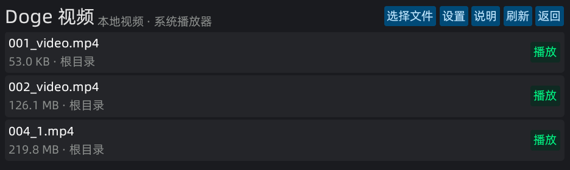
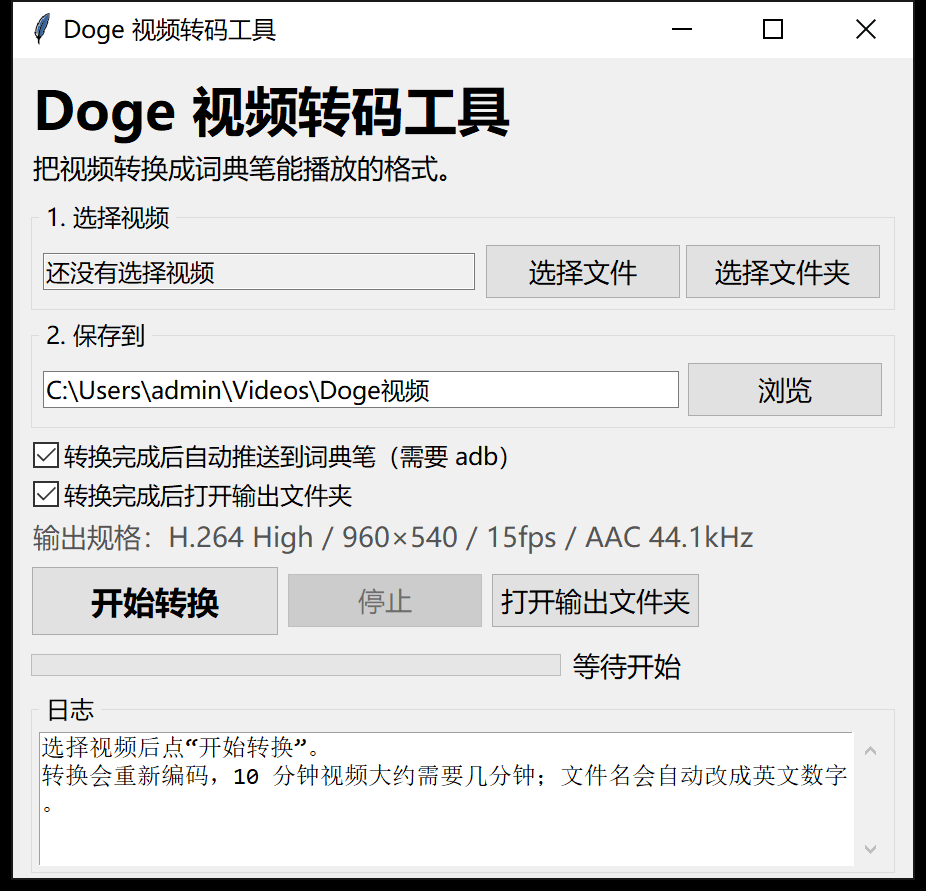
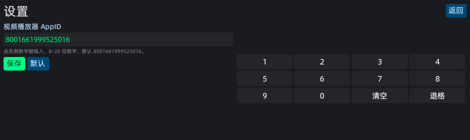

# Doge 视频

[](https://github.com/yangsongh/doge-video)
[](https://github.com/yangsongh/doge-video/releases/latest)
[](LICENSE)

> 项目地址：https://github.com/yangsongh/doge-video  
> 下载：https://github.com/yangsongh/doge-video/releases/latest
>
> 本项目大部分分析、编码、调试和文档工作由 **DeepSeek Harness** 完成；从需求分析到可安装版本，API 成本约 **7 元人民币**。

一个为有道词典笔 OS 做的**本地视频启动器**。它本身不解码视频，而是把选中的本地 MP4 交给系统自带的「视频播放器」播放，因此可以使用硬件解码、声音和系统播放器的进度条。

已验证设备：**YDPX8-1（A7 Pro 类机型）/ OTA 4.61.0**。其他机型、其他固件请先看下面的限制。

## 界面





## 原理

系统里有一个独立的视频播放器小程序：

- appid：`8001661999525016`
- 页面：`pages/index/index`
- 调用方式：

```js
$falcon.navTo('falcon://8001661999525016/index', {
  url: 'file:///userdisk/Favorite/Video/001_xxx.mp4',
  castUrl: 'file:///userdisk/Favorite/Video/001_xxx.mp4',
  title: '001_xxx.mp4',
  from: 'math-book'
});
```

本程序只负责：

1. 扫描 `/userdisk/Favorite/Video`（支持最多两层子目录）；
2. 点「选择文件」时，浏览 `/userdisk` 下的目录和 MP4；
3. 选中文件后，把 `file://` 地址和标题交给系统播放器；
4. 主界面「设置」里可以修改视频播放器 AppID（默认 `8001661999525016`）。

## 视频规格（很重要）

系统播放器对本地文件很挑。实测：

| 规格 | 结果 |
|---|---|
| H.264 **High**、960×540、15fps、AAC 44.1kHz | ✅ 画面 + 声音正常 |
| H.264 Baseline、480×270、30fps、AAC | ❌ 有进度/声音，但画面黑 |
| H.264 High、960×720、30fps、AAC | ❌ 播放器崩溃，设备重启 |
| 数学同步学自带视频（H.264 High、960×540、15fps、AAC） | ✅ 正常 |

所以请统一转换到：

```text
H.264 High / 960×540 / 15fps / yuv420p / AAC LC 44.1kHz stereo / faststart
```

推荐视频码率 600k、音频 96k。单集建议控制在 200MB 以内；超长视频请先分段测试。

## 图形化转码工具（推荐，不需要 Python）

文件：

```text
DogeVideoConverter.exe（从 Releases 下载）
```

这是一个单文件 Windows 程序，**内置 ffmpeg**，用户不需要安装 Python、ffmpeg 或任何依赖。

使用步骤：

1. 双击 `DogeVideoConverter.exe`；
2. 选择视频文件，或选择整个文件夹（会递归查找视频）；
3. 选择输出文件夹；
4. 点「开始转换」；
5. 转换完成后：
   - 如果电脑有 `adb` 且词典笔已连接，可勾选「自动推送到词典笔」；
   - 也可以点「打开输出文件夹」，把文件复制到词典笔的 `/userdisk/Favorite/Video`。
   - 推送使用显式目标文件名（带 `.mp4`），不会再把后缀弄丢。

转换后的文件名会自动改成 `001_xxx.mp4` 这种英文数字格式。

界面上的「输出规格」已经固定为系统播放器验证过的参数，普通用户不需要改。

> 如果 Windows 或杀毒软件提示未知程序，这是 PyInstaller 打包的单文件 exe 的常见误报；可以检查源码 `tools/gui_converter.py` 后自行重新打包。

### 命令行版（可选，给开发者）

如果你更习惯命令行，也可以使用 `tools/convert_video.py`；需要电脑上已有 `ffmpeg`。

```bash
python tools/convert_video.py "D:/videos" -o converted
python tools/convert_video.py "D:/videos" -o converted --push
```

## 目录

```text
src/
  app.js                    应用入口（沿用 Doge 漫画的 BasePage）
  base-page.js              页面生命周期/定时器清理基类（来自 Doge 漫画，AGPLv3）
  app.json                  页面注册
  pages/index/index.vue     视频列表 + 选择文件入口
  pages/filemanager/...     手动浏览 /userdisk 的文件选择器
  pages/help/help.vue       使用说明
  pages/settings/settings.vue  自定义播放器 AppID
  utils/VideoLibrary.js     扫描 /userdisk/Favorite/Video
  utils/FileBrowser.js      浏览 /userdisk 目录
  utils/AppSettings.js      路径、设置文件、播放器 AppID
  utils/tools/isVideo.js    只认 .mp4
tools/
  gui_converter.py          Windows 图形转码工具源码
  convert_video.py          命令行转码脚本
  install_to_device.sh      安装 .amr + 创建清理开关
  fix_app_whitelist_clean.sh 单独开启/关闭清理开关
docs/
  PenUniverse-post.md       PenMods 社区发布文章
```

## 构建

需要：

- Node.js **18 或 20**（Node 22+ 可能无法运行旧版构建工具）；
- `aiot-cli`（来自 `aiot-vue-cli`，提供 `aiot-cli` 命令）：

```bash
npm i -g aiot-vue-cli
npm run build:prod
```

构建产物在项目根目录，形如：

```text
8001145141919820.1_0_0.amr
```

安装：

```bash
adb push 8001145141919820.1_0_0.amr /userdisk/Favorite/
adb shell "miniapp_cli install /userdisk/Favorite/8001145141919820.1_0_0.amr"

# 防止重启后被桌面 cleanUnofficialApps 删除
adb shell touch /userdata/.disable_app_whitelist_clean
```

或者直接运行：

```bash
bash tools/install_to_device.sh ./8001145141919820.1_0_0.amr
```

安装后桌面会出现「Doge视频」图标。

> 当前 appid `8001145141919820` 是本次指定的发布 appid，版本保持 `1.0.0`。
>
> **只改 appid 数字不会自动变成“官方应用”**。系统桌面会从 Overmind 拉取 `appWhitelist`，只有白名单里的官方 appid 才能长期保留；正式发布需要平台分配/上架 appid。没有官方 appid 时，请使用下面的 `/userdata/.disable_app_whitelist_clean` 方案。

## 使用

1. 用图形工具转换视频；
2. 把转换后的文件放到 `/userdisk/Favorite/Video`（或点主界面的「选择文件」手动浏览）；
3. 打开「Doge视频」，点「刷新」，点视频即可。

主界面右上角的「选择文件」会打开文件浏览器，从 `/userdisk` 开始，可以进入子目录并选择 MP4。只建议选择已经转换过的视频；高分辨率原片可能黑屏或让播放器崩溃。


## 自定义播放器 AppID



主界面「设置」里可以修改视频播放器 AppID，默认：

```text
8001661999525016
```

设置会保存到：

```text
/userdisk/Favorite/Video/settings.json
```

只有系统里实际存在的视频播放器 AppID 才能调起；填错时点击视频会提示打开失败。Doge视频默认目录、文件浏览器和播放跳转都会使用这个设置。

## 为什么重启后小程序会从桌面消失

这不是包损坏，也不是视频播放器导致的，而是**系统桌面 App 的主动清理**。

桌面 App（appid `8080222437664451`）在启动/刷新时会执行 `cleanUnofficialApps`：

1. 从 Overmind 配置拉取 `appWhitelist`；
2. 如果白名单启用且非空，把本机已安装的 appid 和白名单比较；
3. 不在白名单里的应用调用 `removePackage` 删除，原因记为 `remove_unofficial`。

设备日志里可以直接看到：

```text
start cleanUnofficialApps
installed: 8001145141919810,8001145141919811,8001145141919812
done, removed: ...
```

所以 Doge 计算器、Doge 阅读、Doge 漫画这类 sideload 小程序会一起消失；Doge视频也一样。

补充证据：

- 系统包在 `packages.json` 里的 `flag` 是 `3`；
- `miniapp_cli install` 安装的包是 `flag: 16384`；
- 被清理的正好是这些 `16384` 的包；
- 清理只在白名单成功拉取且非空时执行，所以断网、配置拉取失败或白名单为空时会跳过，表现出来就像“随机消失”。

### 解决办法（当前设备已启用）

桌面 App 的 JS 里留了一个测试开关：

```text
/userdata/.disable_app_whitelist_clean
```

文件存在时会打印：

```text
disabled by test flag, skip cleanUnofficialApps
```

并跳过清理。当前设备已经创建了这个文件，并做过一次重启验证：Doge视频仍在桌面，包目录也保留。

手动开启：

```bash
adb shell touch /userdata/.disable_app_whitelist_clean
```

注意：

- 这会让所有 sideload 小程序都不再被自动清理，属于绕过系统策略；请只在自己的设备上使用。
- 系统 OTA、恢复出厂设置或清理 `/userdata` 可能删掉这个文件；发现小程序又消失时重新执行即可。
- 真正长期合规的做法是拿到官方 appid 并上架，让 appid 进入 `appWhitelist`；单纯改本地 appid 不行。

### 发布 appid 说明

当前 `package.json` 里是：

```json
"appid": "8001145141919820",
"version": "1.0.0"
```

`8001145141919820` 是本地指定的发布 appid，但它仍然是 sideload 安装（`flag: 16384`），并不在 Overmind 的官方白名单里。因此当前设备继续使用 `/userdata/.disable_app_whitelist_clean` 来避免被清理；如果以后这个 appid 正式上架并进入 `appWhitelist`，就可以移除清理开关。

### 关于 `001_video.` 这样的文件名

转码工具已经改为**显式目标文件名推送**（`adb push local /userdisk/Favorite/Video/001_video.mp4`），不会再依赖「目录 + 斜杠」的推送写法。

设备上实际文件应带完整后缀：

```bash
adb shell ls -l /userdisk/Favorite/Video
# 001_video.mp4
```

如果你是在**系统播放器的标题栏**看到 `001_video.`，那是播放器标题区域对长文件名的显示截断，不是文件后缀丢失；文件本身仍是 `001_video.mp4`，Doge视频列表也会显示完整名称。

## 开发方式与成本

这个项目不是手写全部代码的产物：**系统播放器逆向、视频规格排查、Vue 页面、自绘数字键盘、ffmpeg GUI、重启清理问题定位和文档，大部分由 DeepSeek Harness 完成**。我负责提需求、在设备上操作、看日志和验收。

分析 + 开发过程的 API 调用成本约 **7 元人民币**（不含设备）。在冷门嵌入式设备上，这个成本已经足够把“能不能播视频”跑成可安装、可转码、可分享的完整项目。

完整社区文章见：[docs/PenUniverse-post.md](docs/PenUniverse-post.md)。

## 已知限制

- **依赖系统私有播放器**：`8001661999525016` 的页面和参数不是公开 API，系统 OTA 可能改掉；改掉后本程序需要跟着改。
- **不是自己实现播放**：进度条、声音、暂停、全屏、倍速都归系统播放器；本程序不保存播放历史/进度。
- **返回行为**：系统播放器的返回键可能回到桌面而不是本列表；重新打开「Doge视频」即可。
- **示例视频**：`/userdisk/Favorite/Video/001_testh.mp4` 是测试图案，确认可用后可删除。
- **本地文件路径**：测试使用 `file:///userdisk/...`；日志里会出现 `Can't get file size`，但不影响已验证的规格。文件名建议只用英文、数字、下划线。
- **网络**：已在断网状态下验证：
  - 播放前断网：可以正常打开并播放本地视频；
  - 播放过程中断网：系统播放器会提示“网络未连接”，但不影响已经缓冲/本地文件的播放。
  - 本程序自身不联网，也不上传视频。
- **兼容性**：只在一台 YDPX8-1 / 4.61.0 上验证。别的机型可能没有这个播放器 appid，或页面参数不同。
- **风险**：不兼容的视频可能让播放器崩溃甚至重启设备。请先用 5 秒短片验证，再放长视频。

## 许可与致谢

`src/base-page.js` 来自 [Doge 漫画](https://github.com/adogecheems/doge-comic)（AGPLv3）。本项目同样按 **AGPLv3** 发布，见 `LICENSE`。

系统「视频播放器」的调用方式来自对设备运行时和日志的黑盒分析；本项目不包含该系统 App 的任何代码。
